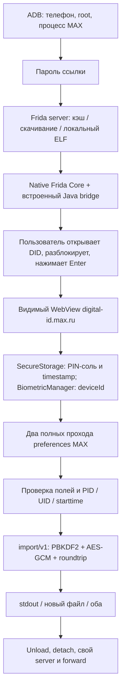

# ID Pocket Exporter — Rust

Одноразовый экспорт Digital ID из установленного MAX в ID Pocket. Один бинарник
под Windows, macOS или Linux; Python, Node и frida-tools при запуске не нужны.
ADB устанавливает пользователь. Нужны rooted Android, разрешённая USB-отладка и
уже настроенный Digital ID.

Статус: экспериментальная версия. Полный экспорт с rooted Android и последующий
импорт в ID Pocket пока не проверены. Результаты автоматических проверок
записаны в [BUILD_STATUS.json](BUILD_STATUS.json).

## Запуск

1. Установите [Android Platform-Tools](https://developer.android.com/tools/releases/platform-tools)
   и добавьте `adb` в PATH, либо укажите `--adb PATH`.
2. Подключите телефон, разрешите USB-отладку и откройте главный экран MAX.
3. Запустите экспортёр, задайте пароль ссылки и следуйте подсказкам.
   PIN Digital ID вводится на телефоне. Пароль ссылки — другой пароль,
   12–256 печатных ASCII символов.
4. Скопируйте всю строку `didpocket://import/v1#…` в ID Pocket и введите пароль.

```powershell
.\idpocket-exporter.exe
.\idpocket-exporter.exe -o did-import.private.txt
.\idpocket-exporter.exe -o did-import.private.txt --stdout
.\idpocket-exporter.exe -v
.\idpocket-exporter.exe --doctor
.\idpocket-exporter.exe --stop
```

На macOS/Linux команды те же, имя программы — `./idpocket-exporter`.
По умолчанию ссылка выводится в терминал. `-o` сохраняет её в новый файл,
`--stdout` вместе с `-o` выводит в оба места. Существующий файл не заменяется.
`--serial SERIAL` выбирает телефон, `--android-user N` — профиль MAX.
При нескольких устройствах/профилях появляется меню выбора.

`--with-biometry` разрешает один штатный системный запрос биометрии для старого
профиля без PIN-соли. Если соль есть, биометрия не вызывается.

Сервер Frida автоматически скачивается с официального GitHub release под ABI
телефона и кэшируется. Для работы без сети передайте распакованный ELF через
`--frida-server PATH`; его версия должна быть **17.23.3**.

Ссылка импорта содержит зашифрованные данные учётной записи. Храните ссылку и
пароль приватно; не добавляйте реальные экспорты в репозиторий. Для локального
файла используйте имя `did-import.private.txt` или каталог `private/`: они
исключены из Git. Произвольное имя файла `-o` автоматически приватным не становится.

В stdout находится только полная ссылка одной строкой без ANSI и префиксов.
Статусы, анимация, меню и диагностика находятся в stderr. В нетерминальном
stderr анимация выключена. Учитываются `NO_COLOR` и `TERM=dumb`.
При перенаправлении пароль читается из управляющего терминала:

```powershell
.\idpocket-exporter.exe > did-import.private.txt
.\idpocket-exporter.exe -v -o did-import.private.txt 2> debug.log
```

`-v` и `--verbose` равнозначны: длительности, команды ADB, версии, PID/UID,
состояния Frida, имена/размеры preferences и ошибки очистки. Пароли, токены и
содержимое снимка/preferences в диагностику не выводятся. Автоматических логов нет.

Коды завершения: `0` — готово; `2` — ошибка; `3` — ссылка готова, очистка не
завершилась; `130` — отмена до вывода. При незавершённой очистке подключите тот же
телефон и выполните `--stop` (при необходимости `--serial SERIAL`).

## Как устроено



Экспортёр читает только известные поля DID и три именованных поля preferences:
`auth.token`, `device.id`, `digitalid-botid`. Отличающиеся кандидаты не угадываются.
Для binary preferences поддержаны Java MUTF-8 и известные типы; для старых
SharedPreferences — XML. Изменившиеся файлы, процесс или origin прерывают экспорт.
Агент ожидает видимый WebView и готовность bridge до срока ожидания.

Формат совместим с Python-экспортёром: AES-256-GCM, PBKDF2-HMAC-SHA256,
310000 итераций, salt 16 байтов, IV 12, AAD `didpocket-import-v1`. Тип
`creationTimestamp` сохраняется. Фото, PIN, документы и launch URL не экспортируются.
MAX API не вызывается; пригодность сессии окончательно проверяется при импорте
в ID Pocket.

Frida handles принадлежат одному управляющему потоку. Native callbacks передают
JSON через канал с корректным временем жизни callback context. Блокирующие
операции используют `GCancellable` и watchdog, а не только Rust timeout.
State-файл хранит serial, уникальный каталог сервера, identity и свой forward;
он позволяет `--stop` после аварийного закрытия. Управляющий RPC token в state
не записывается. Чужие серверы и ADB server не останавливаются.

Каталог загрузки сначала принадлежит пользователю `shell`, от которого работает
`adb push`. После передачи файла root получает каталог и сервер; затем Frida
запускается в штатном режиме демона с ожиданием готовности. Текстовые команды ADB
передают удалённый код завершения, бинарные данные читаются через `exec-out`.

## Сборка

Rust **1.97.1**, C/C++ toolchain и libclang нужны только разработчику.
Cargo автоматически получает static Frida devkit **17.23.3** через закреплённый
`frida-sys 0.17.2`. Версии Core и Android server совпадают. Bundle Java-агента
уже включён в исходники; Node нужен только для его изменения/пересборки.

Java bridge закреплён на официальном коммите
[`b38a5b647d3e6b72aa19bcf8eb5e41c550a0e622`](https://github.com/frida/frida-java-bridge/commit/b38a5b647d3e6b72aa19bcf8eb5e41c550a0e622).
Он включает поддержку ART без `copied_methods_offset_` и исправления Android 17
для поиска флагов методов и перехода состояния потока. Опубликованный npm-релиз
7.0.13 ещё не содержит всех этих исправлений; `npm ci` получает закреплённый архив
с проверкой integrity из lock-файла. Исправленный агент уже встроен в бинарник.

Linux (с C compiler, libclang и liblzma headers) / macOS (Xcode Command Line Tools):

```sh
cargo build --release --locked
cargo test --locked
cargo clippy --locked --all-targets -- -D warnings
```

Windows: Visual Studio Build Tools с C++/Windows SDK и LLVM/libclang. Сборка сама
находит заголовки MSVC/UCRT и подходящий host libclang; обычного PowerShell достаточно:

```powershell
cargo run
cargo build --release --locked
```

Для Windows нужен host LLVM/libclang. При необходимости задайте
`FRIDA_LIBCLANG_PATH` — каталог LLVM `bin` или полный путь к `libclang.dll`.
Локальная копия `vendor/frida-sys` находит MSVC и Windows SDK автоматически.
Она входит в репозиторий и нужна для воспроизводимой Windows-сборки.

Если установленный `stable` уже соответствует 1.97.1, можно использовать
`cargo +stable …`.

Пересборка агента:

```sh
cd agent
npm ci
npm run build
npm test
```

Форматирование всех исходников (из корня проекта):

```sh
python -m pip install -r requirements-dev.txt
npm ci --prefix agent
python scripts/format.py
python scripts/format.py --check
```

Rust форматирует `rustfmt`, JavaScript/TypeScript, TOML, JSON и YAML — Prettier,
Python — Ruff. Настройки редактора находятся в `.editorconfig`; CI проверяет
форматирование. Сгенерированный bundle, lock-файлы и зависимости исключены.

Проверка Rust → Python (только разработка): `pip install cryptography==46.0.3`,
затем `python tests/python_interop.py`. Обратный Python → Rust вектор включён
в `cargo test`. Все фикстуры синтетические.

Аппаратный тест `tests/server_flow.rs` проверяет передачу бинарных данных, загрузку,
запуск и очистку сервера на rooted Android. Он пропущен в обычном `cargo test`;
для запуска задайте `IDPOCKET_TEST_SERIAL` (при необходимости `IDPOCKET_TEST_ADB`)
и выполните `cargo test --test server_flow -- --ignored`.

Аппаратный тест `tests/agent_flow.rs` дополнительно подключает встроенный агент
к работающему MAX, устанавливает Java/WebView hooks, проверяет готовность,
сохранение процесса MAX и очистку. Он не запускает снимок DID. С теми же переменными
выполните `cargo test --test agent_flow -- --ignored`.

CI матрица: Windows x64, Linux x64 (Ubuntu 22.04), macOS Intel и Apple Silicon.
Workflow находится в `.github/workflows/build.yml`; он рассчитан на эту папку
как корень репозитория. Проверяет агент, Rust, криптосовместимость, release и
native dependencies. Здесь CI ещё не запускался, поэтому macOS/Linux-бинарники
и минимальная версия glibc пока не подтверждены.

## Публикация и релизы

Эта папка — корень отдельного репозитория. Исходники, `Cargo.lock`,
`agent/package-lock.json`, `agent/dist/agent.bundle.js` и `vendor/frida-sys`
нужны для сборки. `target/`, `dist/`, зависимости Node и локальные экспорты
исключены из Git.

Перед выпуском бинарников выполните сборку, тесты и проверку CLI:

```sh
cargo test --locked
cargo clippy --locked --all-targets -- -D warnings
cargo build --release --locked
python tests/cli_smoke.py
python tests/python_interop.py
python scripts/package.py
```

`package.py` создаёт новый ZIP в `dist/` с бинарником, README, лицензией проекта,
`THIRD_PARTY.md`, снимком результатов проверок `BUILD_STATUS.json`, лицензиями
зависимостей и SHA-256 файлов. Рядом сохраняется SHA-256 архива. Перед упаковкой
обновляйте `BUILD_STATUS.json` по фактически выполненным проверкам; этот файл
описывает датированную локальную проверку, а не автоматически подтверждает
каждую последующую сборку. Отсутствующие обязательные документы прерывают упаковку.
Старые файлы из `dist/` в новый архив не подмешиваются.

Для GitHub Release загрузите соответствующий ZIP и `.zip.sha256` после успешных
CI-проверок. В CI архивы доступны как artifacts для каждой платформы.
macOS/Linux-сборки и работа с настоящим устройством требуют отдельных проверок;
локальные тесты Windows не подтверждают их работоспособность.

Лицензия проекта — GPL-3.0-only, как у исходного Python-экспортёра.
Сведения о библиотеках — [THIRD_PARTY.md](THIRD_PARTY.md).
